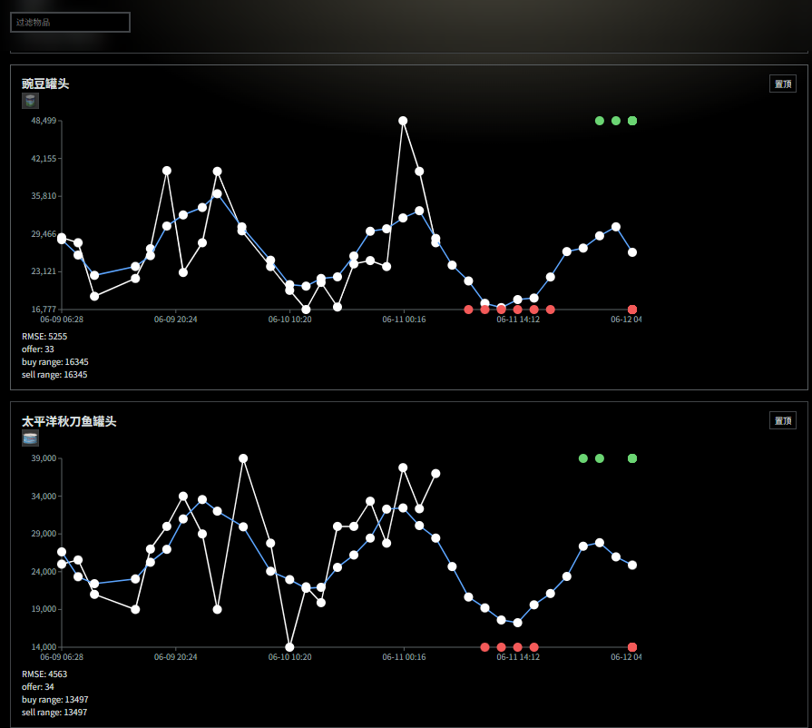

# Tarkogu
使用[prophet](https://github.com/facebook/prophet)预测塔科夫的市场波动。



## 启动与部署

使用 Pixi 安装环境并启动（默认只监听 `127.0.0.1:8080`）：

```sh
pixi install
pixi run serve
```

打开 `http://127.0.0.1:8080/`。前端使用同域 `/api/rankings`；后端同时提供 `/rankings`，兼容现有 Caddy 转发。

生产 VPS 为 `azureuser@74.156.0.0`，仓库放在 `/srv/tarkogu`，systemd 配置见 `deploy/tarkogu.service`。安装环境后复制服务文件到 `/etc/systemd/system/`，执行 `sudo systemctl daemon-reload && sudo systemctl enable --now tarkogu`。新机从 tarkov.dev 重建数据缓存，计算在后台线程中运行；预测过程中每 20 件物品发布一次进度。`data/`、Pixi 环境和临时模型输出不提交 Git。

行情和翻译使用 [tarkov.dev 官方 JSON API](https://json.tarkov.dev/endpoints)，历史价格每批 20 件、最多 4 个下载线程；只使用包含实际报价数量的历史记录。保留旧 VPS 的 21 天参考窗口和 `-RMSE / buy_range` 排名方式，并清理每次拟合的临时输出。

网页路径为 `https://kusurin-tech.icu/toys/tarkogu/`。网站仓库中的 `toys/tarkogu/index.html` 应与本仓库 `frontend/index.html` 同步。

## 分页 API

`GET /api/rankings?page=1&page_size=20&q=医疗&pinned=id:物品ID`

- `page` 从 1 开始，`page_size` 默认 20、最大 100；非法参数返回 422。
- `q` 按中英文名称搜索全部物品，先筛选和置顶排序，再分页。
- `pinned` 可重复传入，使用前端保存的 `id:…` 或 `name:中文|英文` 键；置顶组内部保留行情排名顺序。
- 返回 `updated_at`、当前页 `items`、`page`、`page_size`、`total`、`total_pages`、`has_previous`、`has_next`。超出最后一页会回到最后一页；空结果返回 `page=1`、`total_pages=0`。

搜索、更改每页数量或置顶物品会回到第一页；前端取消过时请求，只绘制当前页图表，并提供空结果、加载失败和重试提示。
